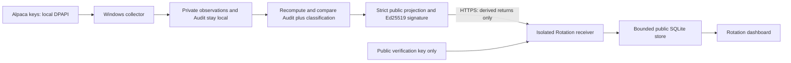

# Rotation website integration — staging only

## Existing architecture and release boundary

The live Render service starts `gunicorn scanner:app` from main. scanner.py
loads the existing extension chain through V5.3.1, preserving its V4.10 engine.
Several legacy after-request hooks inject scanner JavaScript into every HTML
response. The optional `rotation_site:app` WSGI dispatcher therefore sends
Rotation URLs to a separate Flask app and leaves all existing scanner routes
and view functions in the original app. The only scanner response addition is
a static link on the home and scanner HTML pages. No scoring/position modules
or existing production build/start settings are edited.

New URLs: `/rotation`, `/api/rotation` (GET), `/api/rotation/ingest` (POST).
The production entrypoint is not activated: ingest defaults to disabled until
an explicit public-key configuration and database path are supplied. No
production deploy, main merge, Render environment change, or existing local
Scheduled Task update is performed by this feature.

## Data boundary



The exact JSON field allowlist is schema_version, session_date, generated_utc,
feed, and returns. Returns must contain both 5d and 20d for exactly SPY, SMH,
SOXX and the 11 sector ETFs. Only finite numeric returns are accepted. No
Alpaca key/secret, prices, observations, Audit, user/computer identity, local
paths, credential status or collector logs are sent. The server recomputes
the classification from returns; it never trusts uploaded candidate lists.
It cannot independently prove the originating market prices from this public
projection. Authentication means a registered collector signed the summary,
not that institutional fund flows or profitability have been verified.

Signing keys are separate from Alpaca credentials. The Windows publisher
generates a private Ed25519 key and stores it encrypted by DPAPI CurrentUser
in the collector's existing ACL-protected secrets directory. The staging public
key in rotation-staging-public.json is non-secret, scoped only to the synthetic
staging entrypoint. The private signing key is not in Git, environment variables,
command arguments, logs, or Render. No real collector upload is enabled yet.

## Receiver controls

Signatures bind a protocol domain, POST method, exact path, key ID, timestamp,
nonce and SHA-256 body digest. The timestamp window is five minutes. Nonces
are stored transactionally in SQLite and survive process restarts while the
database persists. Duplicate nonces and older same-session publications are
rejected. A new nonce with an identical publication is idempotent. The public
read path checks the exchange session and age again on every read and hides
candidates when stale, missing, invalid or unavailable.

Limits: 8 KiB request bodies, strict JSON including duplicate-key rejection,
4096 recent nonces, 32 public sessions, 128 KiB SQLite connection cache, and
a bounded database/WAL. Connections are closed after every request. No CORS
permission is granted. The page has no JavaScript or external assets, escapes
all values, disables caching, and sets a restrictive CSP. Provider requests
and polling threads are absent from the web extension.

HTTPS is required except explicit loopback-only local staging. The TLS-proxy
option may only be enabled behind Render's trusted HTTPS edge, not on an
untrusted directly exposed HTTP server. Upload redirects are refused and the
publisher explicitly denies the production hostname in this staging version.
Key rotation/revocation is performed by replacing the trusted public-key map;
no server-side shared secret is required.

## Staging and verification

`rotation_staging:app` composes the actual scanner with the isolated receiver
and forces a prominent SIMULATED STAGING banner. It accepts synthetic summaries
from scripts/rotation_stage_publish.py; that script never reads Alpaca values or
private Audit files. The stage service uses no Render environment variables.
Use one worker on a free staging service with auto-deploy disabled:

```
pip install -r requirements-rotation-web.txt
gunicorn --workers 1 --threads 2 --timeout 60 rotation_staging:app
```

Local staging can use Waitress bound only to 127.0.0.1. Full offline tests use
`python -m pytest -q`. The RAM/isolation probe runs 1500 public reads, denies
market downloads, verifies original scanner view-function identities, compares
three position-engine scenarios, checks that Rotation contains no scanner
HTML injections, and asserts no new background threads and under 32 MiB of
incremental RSS. Tests also cover replay after application restart, rollback,
staleness, private-field rejection, invalid signatures, partial coverage and
Windows DPAPI signing-key round trips. Existing scanner files remain byte-identical.

## Still required before production

- Separate explicit approval for production deployment/start-command and
  dependency changes; Render Environment Variables remain untouched today.
- Register a production-only collector public key through an approved public
  configuration delivery path. Never reuse the staging key or embed Alpaca keys.
- Decide durable storage: this SQLite implementation supports a single service
  instance with persistent storage. Free staging uses an ephemeral temp database;
  a restart/redeploy can erase public summaries and nonce state. It fails closed
  until a fresh signed publication arrives. Persistent disk or an equivalent
  shared transactional store and backup policy must be approved before release.
- Wire an opt-in publisher into the installed Windows runner only after that
  target is approved. The present working local automation remains unchanged.
  Republishing the current summary on checks must recover an emptied web store.
- Confirm market-data display/derived-data rights and complete the multi-session
  pilot and independent price-convention reconciliation. IEX is partial-market.
- Review platform-level rate limiting and multi-instance coordination before
  exposing a production receiver. No claim of production hardening is made from
  a small staging load test alone.
